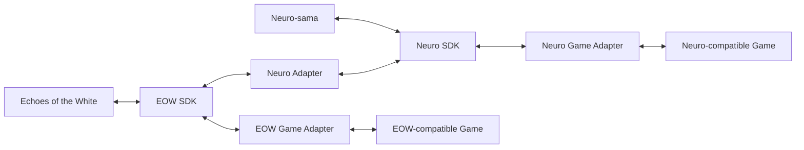

# EOW SDK

A modular SDK and protocol bridge for connecting games and external applications with Echoes of the White and Neuro-sama.

## Overview

**EOW SDK** provides the communication foundation between Echoes of the White, Neuro SDK, and compatible games or external applications. The project currently focuses on transport, protocol validation, and adapter interoperability.

## Status

This project is under active development. Interfaces and protocol details may change as implementation progresses.

## Architecture

## Documentation

- [Changelog](docs/CHANGELOG.md)
- [TODO](docs/TODO.md)

## License

This project is licensed under the [Apache License 2.0](LICENSE).
